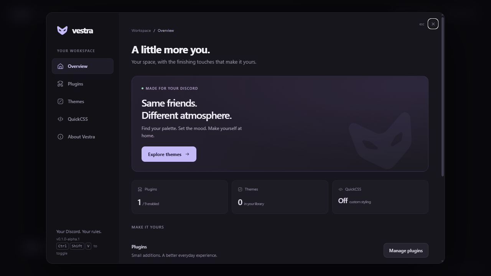
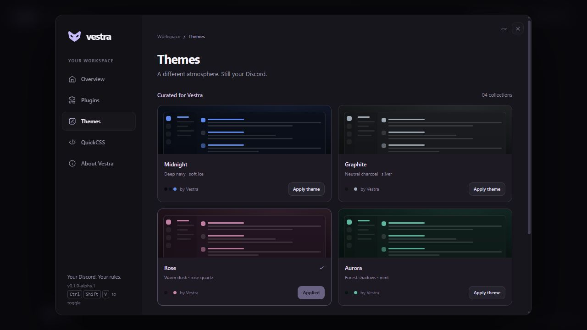

<p align="center"></p>
<h1 align="center">Vestra</h1>
<p align="center">Your Discord. Your rules.</p>
<p align="center"><a href="https://deays.github.io/Vestra/">Website</a> · <a href="https://github.com/deAYS/Vestra/releases">Downloads</a> · <a href="packages/api/README.md">Plugin API</a> · <a href="CONTRIBUTING.md">Contributing</a></p>

Vestra is an open source modification for the Windows Discord desktop app.
It brings a theme library, useful plugins and a live CSS editor into your existing
Discord, with a separate Manager for installation and repair. **Stable is the default.**



**Early alpha:** Windows builds are unsigned. Discord updates can require a repair
or compatibility change. A signed public plugin marketplace and npm publication
are planned; they are not part of this release.

## Get started

1. Download the **Setup** or **Portable** Windows x64 build from [Releases](https://github.com/deAYS/Vestra/releases).
2. Open Vestra Manager, select your Discord installation and click **Install Vestra**.
3. Fully quit Discord from the system tray, then open it normally.
4. Click the floating **Vestra** button or press **Ctrl+Shift+V**.
5. Pick a theme and enable the plugins you want.

The Manager keeps an original backup. **Uninstall** restores it while preserving
Vestra preferences. If a Discord update replaces the modified files, use **Check**
and **Repair** in the Manager. Stable, PTB and Canary can be discovered; GUI operations
target the installation you select.

## Make it yours

**Four curated themes.** Midnight, Graphite, Rose and Aurora change the main Discord
surfaces, input areas and accents. Apply one from the library or import your own
`.css` / `.theme.css` file. The original built-in presets upgrade automatically.

**A movable workspace button.** Drag it to a comfortable spot; its position survives
a restart and stays within the window when resized. Keyboard users can use arrow
keys, Shift+arrow for larger steps, or Home to reset its position.

**Motion with a little personality.** A logo entrance, a startup reveal that opens
from the center, a springy launcher and smooth settings transitions. System reduced
motion preferences are respected.



| Plugin | What it does |
| --- | --- |
| QuickCSS | Apply and edit custom CSS live. |
| ImageZoom | Hold Alt over a chat image; scroll to adjust the magnifier. |
| QuickMessageCopy | Alt-click message text to copy it; add Shift for a permalink. |
| CleanLinkCopy | Alt-click a web link to copy it without common tracking parameters. |
| FullTimestamps | Display the full local date and time, including seconds. |
| CodeBlockCopy | Add a copy button to chat code blocks. |
| FocusMode | Ctrl+Alt+F toggles channel and member sidebars. |
| MessageReadability | Give messages more comfortable spacing. |
| ReducedMotion | Reduce animations and transitions. |

QuickCSS starts enabled. Other built-ins are opt-in. Plugin toggles and preferences
persist locally. Vestra has its **own API**: BetterDiscord and Vencord plugins do not
run unchanged. Imported third-party CSS also depends on the current Discord design.

## Develop

Use Node.js 22+ and Bun 1.4.3. From a fresh checkout:

```sh
git clone https://github.com/deAYS/Vestra.git
cd Vestra
bun install --frozen-lockfile
bun run preview
```

The UI playground opens at `http://127.0.0.1:4173` and does not connect to Discord.
Use `bun run dev` to build the payload and open the Windows Manager.

| Command | Purpose |
| --- | --- |
| `bun run typecheck` | Check TypeScript across workspaces. |
| `bun test` | Run regression tests. |
| `bun run test:electron` | Exercise the production bundle in a disposable Electron fixture. |
| `bun run build` | Build all packages and apps. |
| `bun run manager:package` | Build the Windows Setup and Portable executables. |
| `bun run site:preview` | Build and serve the GitHub Pages site locally. |

Build commands do not modify Discord. Run `bun run build` before using the installer CLI.
The CLI can target discovered
channels; specify one explicitly:

```sh
bun apps/installer/src/bin.ts install --channel stable
bun apps/installer/src/bin.ts check --channel stable
bun apps/installer/src/bin.ts uninstall --channel stable
```

## Write a plugin

```ts
import { definePlugin, Styles } from "@vestra/api";

export default definePlugin({
  name: "UnderlinedLinks",
  description: "Give links a little breathing room.",
  authors: ["Your name"],
  start() {
    Styles.inject("UnderlinedLinks", "a { text-underline-offset: 3px; }");
  },
  stop() {
    Styles.remove("UnderlinedLinks");
  },
});
```

The standalone SDK provides TypeScript definitions, ESM and CommonJS exports.
Its builder registers a plugin against the existing host instead of bundling a
second runtime. See the [API guide](packages/api/README.md) for building a plugin
from this checkout; the npm package is not published yet.

## Project layout

```text
apps/       Windows Manager, installer, store and updater tools
packages/   Renderer runtime, plugin SDK, injector and shared contracts
plugins/    Example plugin and QuickCSS
site/       GitHub Pages source
scripts/    Build, preview and Electron integration tooling
docs/       Development, compatibility, release guide and screenshots
assets/     Brand source and application icons
```

- [Development and test scope](docs/DEVELOPMENT.md)
- [Discord compatibility](docs/DISCORD_COMPATIBILITY.md)
- [Release and Pages setup](docs/RELEASING.md)
- [Roadmap](docs/ROADMAP.md)

MIT licensed. Vestra is independent and is not affiliated with Discord.
